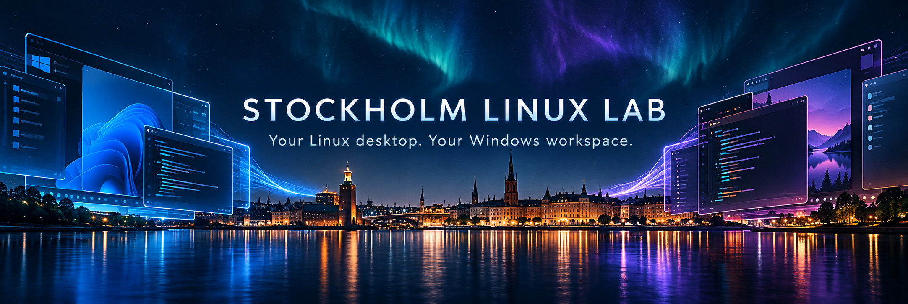

  

  
  
  

<h3 align="center">Independent Linux, WSL and DevOps experiments from Stockholm.</h3>

  Breaking desktops. Building better launchers. Documenting what actually works.

---

## Welcome to the lab

**Mattias Vinberg Linux Lab** is where Windows and Linux desktops meet. The work here explores complete Linux desktop environments on WSL, practical launchers, packaging, diagnostics and the small details that turn an experiment into something another person can actually use.

This is an independent and slightly anarchic engineering lab: try boldly, test honestly and document the result.

## What happens here

| Desktop lab | Distro workshop | Windows bridge |
|---|---|---|
| GNOME, KDE Plasma and other full desktop sessions | Fedora, Ubuntu, NixOS, openEuler and more | WSLg, X11, Wayland, launchers and Windows integration |
| Visible desktop validation | Reproducible setup notes | Start, stop, restart and diagnostics |
| Screenshots and usability checks | Packaging experiments | Audio, clipboard, scaling and input |

## Lab dashboard

| Project | Focus | Lab status |
|---|---|---|
| [Fedora on WSL](https://github.com/vinberg88/fedora) | Fedora 44, KDE Plasma 6 and X410 launcher | ✅ Working reference |
| [NixOS KDE on WSL](https://github.com/vinberg88/wsl-kde6-nixos) | KDE Plasma 6 desktop experiment | 🧪 Lab project |
| [Ubuntu on WSL](https://github.com/vinberg88/ubuntu) | Ubuntu desktop setups and notes | 🔧 Workshop |
| [openEuler on WSL](https://github.com/vinberg88/openEuler) | Packaging and distribution experiments | 📦 Packaging lab |
| [All public projects](https://github.com/vinberg88?tab=repositories) | Linux, Windows and desktop experiments | 🚀 Explore the collection |

> **Lab rule:** a process staying alive is not success. A desktop should open, respond and be useful.

## Follow the experiments

  <a href="https://github.com/vinberg88">Personal GitHub</a> ·
  <a href="https://github.com/enterprises/vinberg">Vinberg Enterprise</a> ·
  <a href="https://vinberg88.github.io/">WSL site</a> ·
  <a href="https://youtube.com/@mattiasvinberg">YouTube</a> ·
  <a href="https://bsky.app/profile/mattiasvinberg.bsky.social">Bluesky</a>

  <strong>Your Linux desktop. Your Windows workspace.</strong> 
  Built and tested by <a href="https://github.com/vinberg88">Mattias Vinberg</a> in Stockholm, Sweden.

